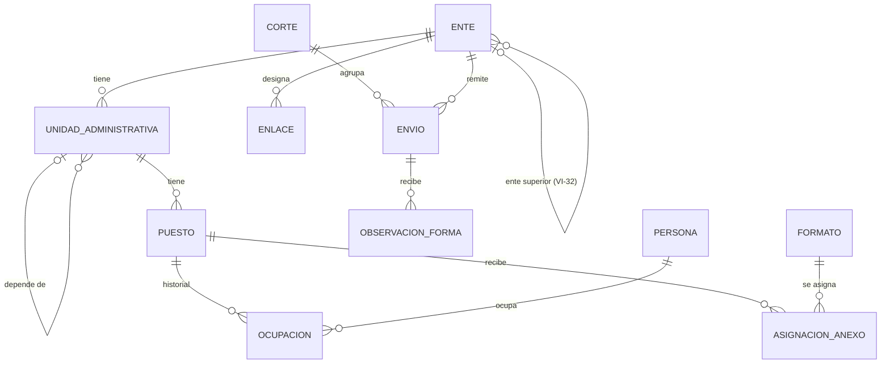

# Modelo de datos conceptual · v1

> 11-nov-2026. Conceptual: tablas y tipos concretos se fijan con el stack (T-01).

## Reglas que la Fase 1 deja para la Fase 2

1. La obligación cuelga del **puesto**, no de la persona; la persona es una ocupación con vigencia (RN-48). Absorbe la rotación de ene a mar-2027.
2. La **unidad administrativa** y su jerarquía son la llave de todo; cada registro de Fase 2 cuelga de una unidad y un puesto.
3. El árbol puede **cruzar entes** (Secretaría → desconcentrado) aunque VI-32 siga abierta; si la DGAJ dice que no, el vínculo queda vacío.
4. El **catálogo de formatos se versiona** con sus campos y su naturaleza (`data/catalogo/`).
5. **Cortes y envíos son entidades**: cada envío guarda su corte, su versión y su folio; un padrón firmado no se edita, se versiona (RN-54).

## Entidades

| Entidad | Campos principales | Notas |
| --- | --- | --- |
| Ente | clave, nombre, tipo (secretaría, dependencia, desconcentrado, descentralizado, fideicomiso, empresa), sector, OIC, fundamento de creación, estado, ente superior | 79 entes preliminares |
| Unidad administrativa | ente, unidad superior, nombre, nivel, fuente documental, vigente desde/hasta | Hasta jefatura de departamento o equivalente |
| Puesto | unidad, denominación, nivel, es titular de la unidad | Sujeto obligado por nivel (Ley E-R art. 3) |
| Ocupación | puesto, persona, carácter (titular, encargado del despacho, vacante), fecha de nombramiento, vigente desde/hasta | RN-48, RN-49 |
| Persona | nombre, apellidos, correo personal, identificador [VI-09 pendiente] | Correo personal (L-01, D-17) |
| Enlace | ente, persona, titular o suplente, oficio de designación, vigente desde/hasta | |
| Formato | clave, versión del catálogo, nombre, tema, subtema, tipo, obligados, naturaleza | `data/catalogo/formatos-v1.json` |
| Asignación de anexo | puesto, formato, asignado por (Enlace), fecha; estado y motivo en Fase 2 | D-19, D-20, D-23 |
| Corte | número, nombre, corte de información, apertura, cierre | Fechas como `[PARÁMETRO]` |
| Envío | ente, corte, versión, folio, fecha y hora, PDF generado (hash, hojas), PDF firmado (hash, hojas), estado | Recibido · En verificación formal · Con observaciones de forma · Verificación formal concluida |
| Observación de forma | envío, texto, autor, fecha, atendida | R3 |
| Bitácora | quién, qué, cuándo, desde dónde, antes/después | Inalterable |

## Pendientes que cambian el modelo

- VI-09: identificador de la persona (RFC, número de empleado o ninguno).
- VI-15: sub-enlaces y su alcance sobre una rama.
- VI-32: integralidad entre entes.
- VI-12: sujetos adicionales del art. 3 párr. 2 desde Fase 1.
